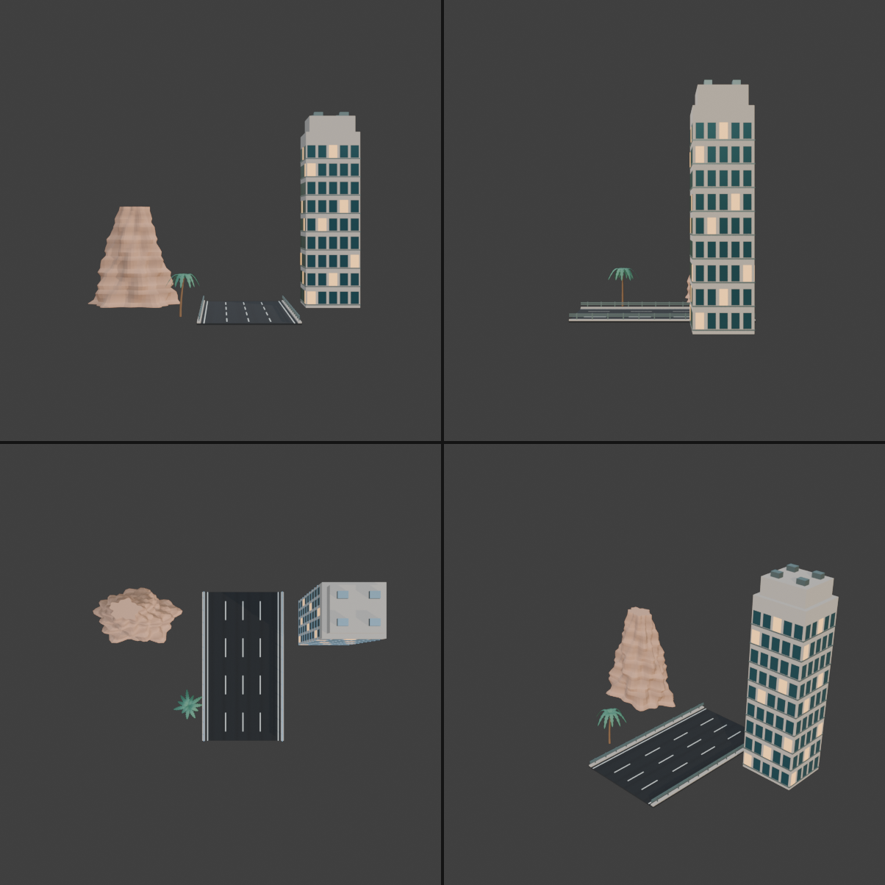

# F02 — Coastal stress kit

Original QRacer geometry and image, MIT (repository LICENSE). Authored through
the existing Blender MCP, Blender 5.3.0. No external media or premium generators.
The editable library is `coast.blend`; reproduce with
`build_coast.build(repository_path)`. It creates an independent scene and refuses
to overwrite an existing scene name. Optional revision suffixes allow inspection.

| Module | Triangles | Detail |
| --- | ---: | --- |
| road | 540 | 24 m tile, asphalt aggregate/wear/cracks, markings, curb and steel barriers |
| palm | 1,042 | Curved ringed trunk and eleven shaped, serrated fronds |
| cliff | 3,196 | Eroded silhouette, terraces and vertex-colored strata |
| tower | 2,340 | Facade belts, glazing/light variation, setback and rooftop equipment |

The GLB roots carry `userData.qracer_asset`: road, palm, cliff, tower.
They share a zero origin for instancing; isolate a root when inspecting the
library. Coordinates are metres, Z-up in Blender and Y-up in glTF. The road
surface is at zero with its slab extending down 0.2 m. A single packed 1024²
asphalt image uses repeated UVs; the other materials use uniform PBR/vertex color.

All four modules pass the game QA profile. Material and wireframe views were
inspected. Accepted warnings: intentional repeated asphalt UVs and slab depth,
five shared crown positions on separate palm fronds, four planar end-cap n-gons
triangulated on export, and eight hidden face pairs where rooftop equipment
rests on the setback. No z-fighting, winding, degeneracy or floating-part errors.

Renderer batching, landscape composition, lighting, shadows and representative
traffic density are validated separately. This library is a measurement sample;
final environment art and additional modular variants remain F06/F08.

