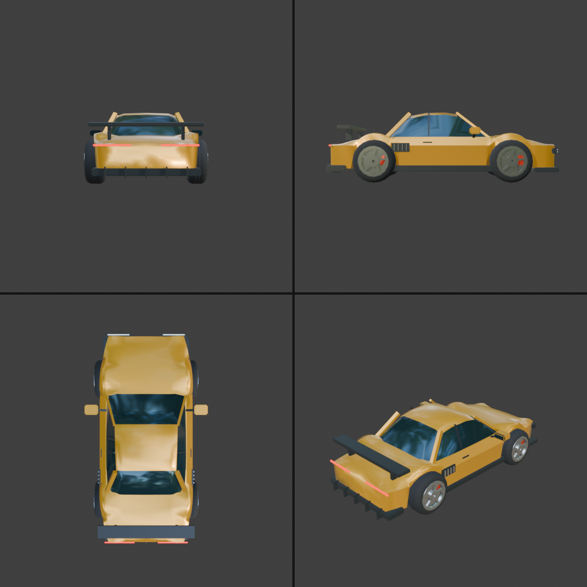

# F02 — Original coupe sample

Original QRacer geometry and production scripts, MIT (repository LICENSE).
No manufacturer, downloaded model, paid generator or external texture is used.
This is a representative engineering sample; final vehicle art remains F06/F08.

Created with the existing Blender MCP, Blender 5.3.0, metres. `coupe.blend`
contains the editable parts. Front is +Y in Blender and -Z in the exported GLB.
The source scene is independent of the owner's original Blender scene.

Run `build_car.build(repository_path)` in Blender, then
`export_car.export(repository_path, source_scene_name)`. Both scripts refuse to
reuse an existing scene name; inspect previous work or provide a new revision.
The export merges 110 parts into eight material primitives per LOD. Select LOD
nodes using the integer `userData.qracer_lod` field, never their generated names.

| Export | Triangles | Materials |
| --- | ---: | ---: |
| LOD0 / close | 14,558 | 8 |
| LOD1 / traffic | 6,112 | 8 |

Dimensions: 2.60 m wide including mirrors, 4.6875 m long, 1.433 m high.
The eight materials distinguish paint, glazing, rubber, carbon, alloy,
calipers, front LEDs and rear LEDs. Traffic batches share them by material.

QA: source and both retained LODs passed `blender-asset-qa` game profile;
material and wireframe views were inspected from multiple angles. Accepted
warnings: four planar source end-cap n-gons triangulated during export, and
62 hidden back-to-back face pairs in LOD1's embedded mechanical/optical parts.
No UV, floating-part, winding, degeneracy or z-fighting errors remain.
The aggressive 22% LOD failed QA and is deliberately absent from the GLB.
UVs are repacked per triangle for uniform PBR; new baked textures require a
dedicated unwrap. Shader loading and scene performance are measured separately.

